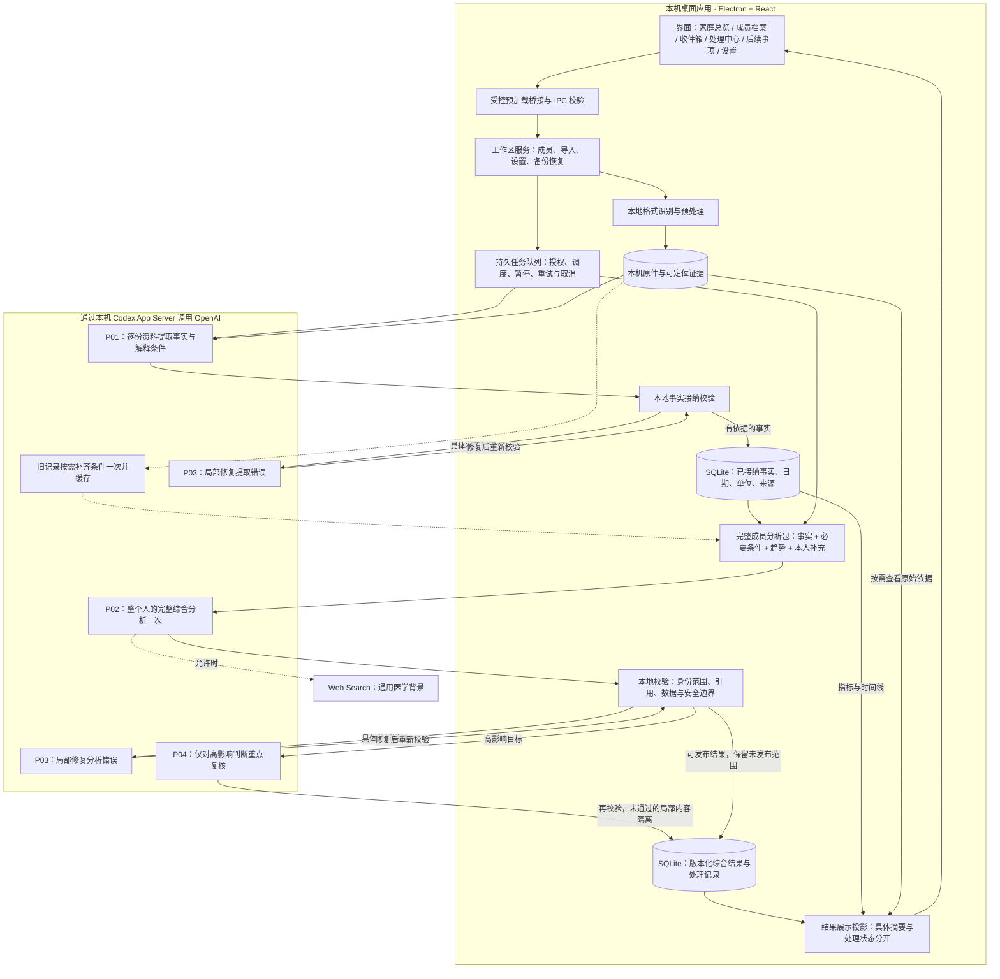

# 桌面端架构

家庭健康看板是 Electron + React 的本机应用。渲染层只通过预加载桥接调用经过 Zod 校验的 IPC；主进程管理工作区、SQLite、不可变原始对象、Codex App Server 与本机文件预览。

以下描述的是 `dashboardApp` 当前桌面实现（2026-10-01），不是上层目录早期 PWA / Supabase / Gemini 技能管线。

数据流程：

1. 导入字节先写入按 SHA-256 寻址的对象库。
2. 本地规范化产生完整 `SourceManifest` 和可定位 `SourceSpan`。
3. 每份文档优先整篇提取一次（P01），本地规则校验成员、覆盖、引用内容与日期。只有具体错误才执行一次限定范围的 P03 修复，不固定重复提取整篇。当前 P01 在视觉页数、片段数或字节硬限制触发时仍有保护性分块；这与下述成员综合不分段是两个不同层面。
4. 文档事实、修订号、文档完成状态以及稳定提交键在同一 SQLite 事务中写入。
5. 成员综合（P02）一次读取全部可用的已接纳事实、必要解释条件、确定性趋势和用户补充。本地校验后，有错误才执行 P03，高影响判断才执行 P04 重点复核。无法通过的局部结果被隔离，其余结果保存成版本化快照，不回滚已接纳事实。
6. 工作区服务构建只读展示投影，界面按成员总览、身体系统、时间线、生活与行动和原始资料读取，不因浏览页面重新调用模型。

P01、旧报告条件补齐、P03 修复、P04 重点复核禁用 Web Search；仅 P02 按用户设置允许联网查询医学背景。搜索结果不能替代或改写报告事实。当前内置搜索词无法在发送前由应用拦截，去标识化指令不是已完成的隐私门禁；用户选择保持开启并知晓风险。命令沙箱保持只读且 `networkAccess = false`，shell、browser、apps、plugins 和 MCP 等能力在 App Server 进程级显式禁用；这不等于内置 Web Search 被禁用。锁定版 Codex 0.156.1 的真实 `thread/start` 兼容性探针覆盖搜索禁用与实时两种配置。

事实提取固定使用 `gpt-5.6-sol` 与 `medium`；成员综合分析和复核默认使用 `gpt-6-sol` 与 `medium`，可在设置页手动更改。设置页通过 App Server 的 `model/list` 读取当前账号真实可用、同时支持文本和图像的模型，再只展示该模型声明支持的推理强度；保存时主进程会再次校验组合。任务领取时冻结分析设置，后续变更只影响新任务。综合快照记录实际分析模型与强度；同时包含提取和分析的任务，`job_attempts` 记录先执行的提取模型。

分层包：`contracts` 定义边界，`ingestion` 负责本地规范化，`health-core` 负责确定性接纳规则，`storage` 负责事务与审计，`apps/desktop` 组装运行时和界面。

关键不变量：未授权不发送；取消或撤权后迟到结果不落库；一份文档只有一次事实提交；原始依据可回链；派生内容不覆写事实。

## 整体架构与主流程

图中跨出本机的模型调用都经相同授权和执行栅栏；原始资料留存在本机，不代表必要内容从不发送给 OpenAI。提取与综合各自的 P03 只返回自己的校验路径，不会相互混用。旧条件补齐仅在缺少可用缓存时触发，不代表每次都重读全部报告。全文容量超过成员综合的硬限制时停止并保留已有结果，不分段或截断。

主要代码入口：[主进程与 IPC](../../apps/desktop/src/main/index.ts)、[队列](../../apps/desktop/src/main/job-runner.ts)、[事实提取](../../apps/desktop/src/main/processing-pipeline.ts)、[成员综合](../../apps/desktop/src/main/member-assessment-pipeline.ts)、[存储](../../packages/storage/src/index.ts)、[成员界面](../../apps/desktop/src/renderer/src/features/member/MemberProfileV2.tsx)。

## 局部隔离后的摘要展示

`result-summary-v1` 是独立的只读展示版本，不改变模型提示词、接纳规则或健康事实版本。已发布快照经过原有成员、事实/背景版本、核对范围及规则有效性检查后，才进入 [摘要投影](../../apps/desktop/src/main/assessment-presentation.ts)。

- 仅识别局部隔离产生的占位标题/摘要，或明确隔离的摘要节点；没有受影响的系统保持原状。
- 摘要只复用该节点仍然引用的可发布判断原句及其重要不确定条件，不恢复 held 节点，不从其他系统借结论，不添加新的医学解释。长度不足时整条留在详细解读，不截掉否定、条件或单位。
- 原始模型结果、处理状态与 held 记录不改写。投影随读取生成，因此旧结果无需清空、重新上传或再调用模型。
- `presentation.rebuiltNodeIds` 仅是展示来源标记，不是新的校验证明；身体目录的 `interpretationState` 与健康状态分开。局部隔离不能自动推出“继续观察”，没有可用判断也不能据此声称“没有检查”。
- 健康总览和身体摘要展示具体内容，处理说明收在单独的范围说明中；各条判断的重要临床不确定条件继续就地显示。
- 本次修复不解决尚未纳入的历史报告项目，不重新接纳被隔离的判断，也不代表已经完成医学质量或公开发行验收。

## 指标入口与可比序列分离

身体页的指标入口由 [只读分组](../../apps/desktop/src/renderer/src/features/member/metric-presentation.ts) 生成：已验证概念按概念编号合并阅读入口，其余仅按规范空格和全角符号后的精确原名合并。模型候选、不同概念和左右侧不模糊合并。底层原值、单位、检测条件、来源和趋势序列保持不变，不需要重新提取或成员综合。

- [指标历史](../../apps/desktop/src/renderer/src/features/member/MetricHistory.tsx) 同时展示所有分组的全部历史表格，单位、标本、方法和部位不同的序列通过选择器分别看图。任何一组读取失败都提示重试，不把部分历史冒充完整历史。
- 未明日期不冒充最新记录，同日存在多个不同结果时不任取一个代表。不可比点、界限值不绘点；同日多条记录不连接趋势。
- 数值原文已带相同单位时不重复追加单位，不换算、不修正 OCR 数值；原报告明确空白/未检测的项目放到单独折叠区，阴性、未见异常和零值继续正常显示。
- 这是阅读层改动，不代表原有别名映射、日期缺口、未接纳项目或被隔离的综合判断已经补齐。

## 成员综合的完整上下文精简

成员综合 P02 使用 `member-analysis-v2` 分析输入及 `member-evidence-table-v1` 传输表示，提示词版本为 `member-assessment-v11`。事实提取为 `extract-v8`，解释条件契约为 `clinical-record-v1`。分析投影与本地证据存档分开：

- 重复字段名放到共享列定义中，每条记录保留全部字段值（含 null、空数组及日期精度）。
- `facts` 保留全部已接纳正常/异常/历史/文字结果及其临床字段。新提取在 `clinicalContext` 中保留影响解释而尚未由其他字段表达的条件，逐条引用连续原文；未知条件不得冒充已完成。SQLite v36 为观测修订增加可空的条件字段，升级前自动备份，旧记录保持 null，不自动冒充完整记录。
- 旧记录只按原报告补齐解释条件，不重新提取或改写已接纳数值。补齐读取该报告文字来源且禁用搜索；缓存绑定成员、文件、事实、原件内容与规则版本，次日综合及新增其他报告不导致同一来源反复补齐。发送前、返回后及缓存写入时检查授权/取消、事实和背景版本。纯图像缺文字、输出不完整或条件引用不合格时保留 unresolved 与原文边界，不编造条件，不新增逐项人工确认。
- `conditions` 只发送必要条件文本；完整来源保留本机。完成条件整理的事实不再因原文标签、标点或排版与字段不同而重发整段原文。`sourceContext` 仅保留 legacy/unresolved 记录的原文，关联事实编号，不能将其中未接纳项目升级为新事实。相同原文只发送一次。
- 个人结果只引用 `facts.observationId`，不再重复发送事实编号及每项事实到多处原文的索引。相同身体系统归属放到 `systemGroups` 共用，`factSourceKind=report` 统一标明报告事实。`evidenceCatalog` 仅含非观测来源，如本人补充。应用在本地将事实引用还原成全部原始依据和解释条件依据，再进行原有验证、重点复核和发布；原件、页码与证据档案不删除。
- 趋势点通过 `observationId` 引用事实，不重发结果原文、来源目录和显示标签；与事实严格相同的日期值、数值、比较符和单位不重复。归一化差异、参考边界、时间性质、可比性限制、重复来源计数及确定性趋势计算保留。普通单点只去包装；日期性质独有的单点保留。未知结构或事实关联冲突保留原趋势，不猜测裁剪。
- 冗长 ID 在单次请求中换成稳定短编号，本地保留映射；P02 和 P03 的返回值先恢复编号，再仅将 evidenceIds/counterEvidenceIds（包括诊断条件中的引用）从事实映射到真实来源。正文、数值、比较符、单位、部位和日期不做字符串替换。
- P02 一次读取完整成员资料；P03 结构修复也读取完整紧凑资料。P04 仍仅复核高影响目标，不是按身体系统拆分成员综合。
- 提示文本超过 1,000,000 字符或运行时返回明确容量错误时，报 `MEMBER_ASSESSMENT_INPUT_TOO_LARGE`，保留既有结果，不自动分段、截断或改发摘要。历史分区快照仍可读取，但新综合不再走分区回退。

测试要求：全部事实的临床字段逐字段保持；来源关系在本地完整保留，编号还原覆盖主张、反证、诊断条件、行动和问题。紧凑传输展开后与分析投影相等（不宣称可从投影恢复完整本地档案）；未知引用仍被拒绝。覆盖跨日期、左右侧、比较符、未知结构、条件伪造、旧数据只补一次、取消后的迟到缓存、完整分析、局部修复和重点复核/发布链路。字符数不等于 token 数；合成测试及体积测算不等于真实模型理解质量已获验收，真实模型端到端验证需单独记录。
