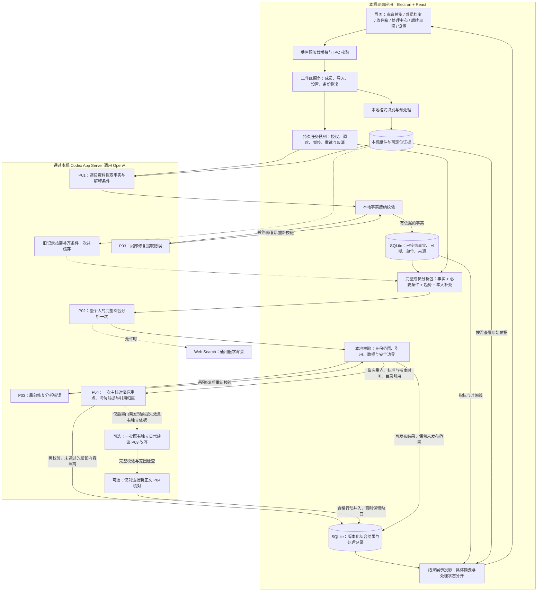

# 桌面端架构

家庭健康看板是 Electron + React 的本机应用。渲染层只通过预加载桥接调用经过 Zod 校验的 IPC；主进程管理工作区、SQLite、不可变原始对象、Codex App Server 与本机文件预览。

以下描述的是 `dashboardApp` 当前桌面源码（2026-10-18），不是上层目录早期 PWA / Supabase / Gemini 技能管线；源码变更不等于已安装版本或真实模型验收完成。

普通上传采用 [上传后自动整理](automatic-upload-flow.md)：用户选定成员并上传即启动这次原件整理与后续成员综合，必要的恢复和模型复核在后台执行，不再要求用户逐阶段批准。读取缺口作为结果范围说明，不把不可靠内容强行纳入；登录、额度、撤权及取消等真实执行边界仍然保留。下文显式重核、日期修正和清理的授权说明仅适用于这些高级操作，不是普通上传的必经步骤。

数据流程：

1. 导入字节先写入按 SHA-256 寻址的对象库。
2. 本地仅做文件格式与哈希检查、完整页面渲染和来源骨架准备，不进行 OCR 或医学内容识别。PDF 无论是否有文字层，所有原页都直接交给模型；JPG/PNG 保留原始图像，TXT 保留全文。DOC/DOCX 必须先用受控转换器生成完整 PDF 页面，缺转换能力明确阻塞，不退成可能缺图片/页眉/表格的文字。
3. 每份原件由 GPT-6.1-Sol / medium 一次整篇识别（P01），返回逐页读取状态、结果盘点、原文摘录和结构化事实。应用分配出处 ID 并记录真实模型调用、原件哈希和页码；不再拿本机 OCR 的字符或行窗口当作医学真值。技术校验检查授权、成员、页覆盖、引用、日期角色及数值 JSON 自洽。具体问题最多一次限定目标的 P03，必要时按完整依赖分包且每包仍提供整份原件；不可分依赖超容量时明确停止，不截断原文，不改动已完成事实。

逐页结果盘点 `resultInventory` 由模型直接查看原件后生成，再与候选逐项对账，不由脚本识别或从已提取候选倒推。即使别页已有结果，本页无候选或盘点项没有对应候选也进入一次有界补漏；清晰但尚未接纳的候选不因此被误称没读过。补漏请求保留清单引用的完整只读摘录，候选引用变更需同步核对已授权页清单。旧断点没有清单时保留缺口，不伪造完整性，也不重置已经使用的修补预算。该机制仍依赖模型能看到并盘点原件，不能证明现实报告绝无遗漏。

来源不同与来源相同使用不同证明：真实同页连续上下文中的唯一互斥位置，或已证实互斥的行列坐标，可证明不同字段；另一个未知维度不抹掉这个互斥证明。相同字段及来源补强仍要求完整原文关系，名称、数值相同或模型自行编号都不能替代证明，同格矛盾仍保留。

连接恢复优先采用运行时结构化 `codexErrorInfo`（HTTP 连接、流连接、流断开及恢复次数耗尽），兼容只有 “Reconnecting” 的提示。明确 `willRetry` 连接故障仍受连续 5 分钟或 8 次通知的本次 turn 上限约束，只有真实非空内容恢复才重置；普通长推理不按时长误杀。认证、额度和限流优先分类，不伪装成连接故障。诊断仅保存固定原因码、有限服务码和安全回执，不保存原始服务正文或报告内容。
4. 文档事实、修订号、文档完成状态以及稳定提交键在同一 SQLite 事务中写入。
5. 成员综合（P02）一次读取全部可用的已接纳事实、必要解释条件、确定性趋势和用户补充。本地校验后，有错误才执行限定目标的 P03；高影响判断、标准匹配、指南医疗随访时间、所有临床问句的事实前提及目录引用目标合并为一次主 P04。若主 P04 后的本地门禁才发现前提失效，仅对已有、仍有独立个人依据的低风险日常建议，允许额外一批 P03 改写及一批局部 P04，不重跑 P02 或整份复核。普通解释的引用不匹配仅撤下引用，不删除个人内容；无法通过的医学判断、问句或行动局部隔离。其余结果保存成版本化快照，不回滚已接纳事实。完整分类与调用上限见 [综合发布门禁](assessment-publication-gates.md)。
6. 工作区服务构建只读展示投影，成员页依次为健康总览、身体与指标、日常生活、检查时间线、原始资料，不因浏览页面重新调用模型。

本机原件准备最多两份并行，后半段来源补核与接纳按成员保护；全部文档落定后再进入成员综合。最多十个不同成员任务推进，所有阶段共用全局自适应模型许可池：从四路起步，稳定后逐档升到十路。读完报告可在原任务内持久交接到综合阶段，让出工作位给其他成员的待提取资料；不重复已完成提取。停止任务只影响自己的调用，繁忙或限流后降低并发并有限冷却恢复。调用隔离、断点恢复和长 PDF 的边界见 [报告读取与并行调度](report-reading-performance.md)。

P01、旧报告条件补齐、P03 修复、P04 重点复核禁用 Web Search；仅 P02 按用户设置允许联网查询医学背景。搜索结果不能替代或改写报告事实。当前内置搜索词无法在发送前由应用拦截，去标识化指令不是已完成的隐私门禁；用户选择保持开启并知晓风险。命令沙箱保持只读且 `networkAccess = false`，shell、browser、apps、plugins 和 MCP 等能力在 App Server 进程级显式禁用；这不等于内置 Web Search 被禁用。锁定版 Codex 0.160.1 的真实 `thread/start` 兼容性探针覆盖搜索禁用与实时两种配置。

事实提取固定使用 `gpt-6.1-sol` 与 `medium`；成员综合分析和复核默认使用同一组合，可在设置页手动更改分析配置。设置页通过 App Server 的 `model/list` 读取当前账号真实可用、同时支持文本和图像的模型，再只展示该模型声明支持的推理强度；保存时主进程会再次校验组合。任务领取时冻结分析设置，后续变更只影响新任务。综合快照记录实际分析模型与强度；同时包含提取和分析的任务，`job_attempts` 记录先执行的提取模型。

分层包：`contracts` 定义边界，`ingestion` 负责本地规范化，`health-core` 负责确定性接纳规则，`storage` 负责事务与审计，`apps/desktop` 组装运行时和界面。

关键不变量：未授权不发送；取消或撤权后迟到结果不落库；一份文档只有一次事实提交；原始依据可回链；派生内容不覆写事实。

## 整体架构与主流程

图中跨出本机的模型调用都经相同授权和执行栅栏；原始资料留存在本机，不代表必要内容从不发送给 OpenAI。提取与综合各自的 P03 只返回自己的校验路径，不会相互混用。旧条件补齐仅在缺少可用缓存时触发，不代表每次都重读全部报告。全文容量超过成员综合的硬限制时停止并保留已有结果，不分段或截断。

主要代码入口：[主进程与 IPC](../../apps/desktop/src/main/index.ts)、[队列](../../apps/desktop/src/main/job-runner.ts)、[原件直读](../../apps/desktop/src/main/direct-original-extraction.ts)、[成员综合](../../apps/desktop/src/main/member-assessment-pipeline.ts)、[存储](../../packages/storage/src/index.ts)、[成员界面](../../apps/desktop/src/renderer/src/features/member/MemberProfileV2.tsx)。旧 processing-pipeline 仅保留旧记录兼容与合成回归，生产队列不走旧 OCR 提取入口。

## 全量清理与重建

正常设置入口先验证恢复点与全部原件哈希，再在一个事务中清理并重新排队。默认只重建报告结果；另有强确认选项“仅保留原件和成员”，清理旧事实、核对、综合、本人补充、计划、旧授权/任务及通知，保留原始对象、成员及已确认身份别名。来源骨架不携带旧 OCR 或模型文字。恢复点不删除，个人计划不能因普通重核被清理，强确认作用范围变更会重新要求确认。

P04 中结构合法但超出已核对医学范围的替换先隔离，依赖该前提的行动不能继续沿用原通过编号。有独立个人依据的既有低风险日常建议可走有界补救：常规前后修复共用两次 P03；主 P04 后本地门禁新发现的依赖失败，另有最多一批 P03 加一批局部 P04，核对实际改写后的正文。模型明确拒绝的行动不进入这个后置补救。不能因一个判断被隔离而整类删除饮食等建议，也不能仅删失效引用却保留没有来源的新医学正文。没有独立依据、用药变更、高影响判断及不合格修复仍隔离，不循环重试至全部发布。

如果日常行动正文完全未改、仅存活前提经后置校验修正，V82 允许一批 `final_habit_premises` 复核，用最终依赖和真实来源取得新的精确 pass。该批不改写行动，拒绝或缺失回执时保留缺口，也不能再进入后置改写补救。原医生安排、显式 hold、改药或缺个人来源不适用。V83 将有真实来源的缺资料断言核对合并进前置 P03，让完整纠正版本进入 P04；全部叶子定稿后，退化摘要另有一次 P03 撰写和 `final_aggregate_summary` P04 复核机会，只概括原重点范围中最终保留的内容，不能改叶子或恢复隔离内容。常规两次 P03、一次主 P04，加最多一次前提 P04、互斥行动目标的最多一次后置 P03/P04，以及最后一次摘要 P03/P04，最坏为四次 P03、四次 P04；无需补救时不追加调用。以下既有后置改写段落的预算仅描述该独立通道，不包含最终前提复核和摘要撰写。

## 局部隔离后的摘要展示

`result-summary-v12` 是独立的展示版本，不改变事实接纳规则或健康事实版本。发布时局部隔离摘要与旧快照的只读展示共用 [摘要投影](../../apps/desktop/src/main/assessment-presentation.ts)；已发布快照经过原有成员、事实/背景版本、核对范围及规则有效性检查后，才进入展示。短标题与完整正文分开，完整解释、条件和行动的段落在界面去重时继续保留。

整体总览与单个身体系统使用不同摘要函数。总览兼容重建按仍合格的主体主题组织，优先重要判断，不再为全部系统拼接目录。实际身体解释只摘用完整的主张、理由、不确定条件和节点限制单元；过长单元整体留在详情，不截断否定或检查条件。次关联不能代替另一个系统的主体概况，例如甲状腺的免疫关联不取代血常规。家庭入口与成员总览共用同一完整概况，长正文可展开；主题入口不推导新的正常、疾病或风险结论。没有变化且有效的模型整体总述继续原样读取；历史展示投影不写数据库，不恢复被隔离的医学判断，也不冒充新一轮分析。

- 识别局部隔离产生的占位标题/摘要及明确的工程过程表达；“系统性疾病”、临床复查、检查条件不是软件过程。没有受影响的系统保持原状。
- 旧说明混合工程过程与临床条件而无法精确拆开时，整条判断及依赖行动、提问不进入健康正文，不删条件后继续保留肯定判断。同源判断无法证明独立时也保守收敛，受影响摘要从独立保留的具体判断重建；原始报告、已接纳事实及全部来源不删除、不改写。
- 每条判断可有一个不超过 80 字的独立短标题，旧结果没有标题时使用身体系统的中性检查标题，不从正文截取一句充当结论。摘要完整保留首条判断、理由、不确定条件及节点必要条件，再按容量加入同一时间性质、共享证据 ID 的现成解释；行动独立展示其理由、第一步、时间、回看安排和提醒，不再重复塞入摘要。容量不足时整组留在详情，不裁掉条件或句尾。
- 明确诊断的短标题不能比主张本身更肯定，总览与系统标题同样检查。确定性越界的新候选先局部修复，仍失败则沿依赖隔离；旧快照读取时只把越界标题换成中性入口，保留正文、日期和临床限制，不更改报告记载的历史诊断。
- 不恢复 held 节点，单个身体系统不从其他系统借结论，总览也只使用同一成员的合格结论，不添加新的医学解释。长度不足时整条留在详细解读，不截掉否定、条件或单位；完整事实组和节点必要条件超出摘要容量时改为完整结果入口，不单独呈现脱离条件的肯定结论。
- 原始模型结果、处理状态与 held 记录不改写。投影随读取生成，因此旧结果无需清空、重新上传或再调用模型。
- `presentation.rebuiltNodeIds` 仅是展示来源标记，不是新的校验证明；身体目录的 `interpretationState` 与健康状态分开。局部隔离不能自动推出“继续观察”，没有可用判断也不能据此声称“没有检查”。
- 健康总览和身体摘要展示具体内容，处理说明收在单独的范围说明中；各条判断的重要临床不确定条件继续就地显示。
- “小结仍可用于分析”“事实尚未归入系统视图”“总览已纳入可确定内容”等纯工程分句在共享正文规则中精确识别；旧结果逐分句移除，新候选沿用局部修复门禁，不删除相邻的影像缺口、数值、历史日期或病因未知。成员提示词 v16 不再要求在健康总览讲述系统视图覆盖，但仍要求解释未归类的可靠事实。标题、正文、理由和限制均受同一内容边界检查。
- “程序提供的差值”仅去除计算来源标签，差值、方向、单位及比较条件原样保留。“报告中有明确的肯定安排，可按原文保留”等独立编辑说明不进入健康正文；实际医生建议及临床语境中的“保留目前活动计划”不清理。
- 内部 UUID、文件名及本机路径不能夹在解读正文里，来源位置仍可在原始依据中查看。明确“历史正常被写成现在正常”或“同项目明确未知被写成正常”的内容先局部修正；旧快照读取时只屏蔽矛盾判断、重建依赖摘要，不改原始事实，也不连带否定其他独立检查。
- 已采纳的历史 AI 行动使用只读展示投影；本人填写的目标、起始方式、时间、负责人、备注和进度不清理改写，原报告中的医生文字也不改写。
- 本次修复不解决尚未纳入的历史报告项目，不重新接纳被隔离的判断，也不代表已经完成医学质量或公开发行验收。

## 日常生活与医疗安排分开阅读

P02 在一次完整成员综合中评估饮食与摄入、运动与活动、睡眠与休息、营养补充与保健品、日常习惯与自我观察五个领域，不另起五次分析。每条建议保留作用和适用理由、具体做法、试行/回看安排、限制与来源；补充剂领域可以明确说明目前没有新增的依据，不能为了补齐栏目生成购物清单、处方或无依据剂量。

`HealthAction` 的可选 `lifestyleDomain` 与 `lifestyleBasis` 区分主题和依据。个性化建议仍必须有个人来源；严格常规、非医疗的 habit 可引用仍存活的关联主张，由 P04 读取该主张的唯一可定位来源核实，不能拿两个候选节点相互背书。通用建议仅允许无个人判断引用的低风险日常习惯，不包含治疗目标、医疗安排、个人肯定病情或补充剂剂量。通用内容在页面明确标记，不能伪装成依据本人的检查。含数字或中文数量的补充剂剂量进入临床重点复核；保留原医生安排的来源门禁。P03/P04 只修改获准目标；后置补救也只处理 P02 已有行动，不因五域缺失新增行动、追补回合或把未发布内容改成假通用建议。

页面先显示日常生活主题，再显示复查与就医、我的计划和真正影响建议的待补充信息。同一项建议只出现在一个主领域；医嘱始终单列。旧结果未带字段时只按明显文字保守归组，不推断个性化依据。缺领域时显示更新入口，阅读页面不会自动发送资料或填入假个性化模板。已有行动、本人安排、原建议时间与来源继续保留，过期结果不能新增采纳。

## 指标入口与可比序列分离

身体页的指标入口由 [只读分组](../../apps/desktop/src/renderer/src/features/member/metric-presentation.ts) 生成：已验证概念按概念编号合并阅读入口，其余仅按规范空格和全角符号后的精确原名合并。模型候选、不同概念和左右侧不模糊合并。底层原值、单位、检测条件、来源和趋势序列保持不变，不需要重新提取或成员综合。

- [指标历史](../../apps/desktop/src/renderer/src/features/member/MetricHistory.tsx) 同时展示所有分组的全部历史表格，单位、标本、方法和部位不同的序列通过选择器分别看图。任何一组读取失败都提示重试，不把部分历史冒充完整历史。
- 未明日期不冒充最新记录，同日存在多个不同结果时不任取一个代表。不可比点、界限值不绘点；同日多条记录不连接趋势。
- 数值原文已带相同单位时不重复追加单位，不换算、不修正 OCR 数值；原报告明确空白/未检测的项目放到单独折叠区，阴性、未见异常和零值继续正常显示。
- 这是阅读层改动，不代表原有别名映射、日期缺口、未接纳项目或被隔离的综合判断已经补齐。

### 逐项记录日期的统一读取规则

`observation-recorded-time-v1` 在指标历史、事件详情、身体系统和成员综合中共用：原事实明确的 `clinicalDate` 优先；没有时，先复用该事实已接纳的专门日期引用，引用必须在同原件可信摘录中唯一定位，且不与已有日期标识矛盾。普通结果没有单项日期时按有出处的报告主要日期记录，显示“按报告日期记录”，不要求重复确认。事实表与旧修订的日期不改写。

P04 的 `factTimes` 只携带当前目标实际引用事实的原日期、记录日期与文档背景，保持 observationId 对应关系；同文档未引用项目不随之扩入。复核必须保留有依据的报告日期标注，不能只看空的单项日期或空摘录就撤掉记录时间。原报告安排只依赖必要事实和条件；可选历史解释被隔离后，模型必须明确替换并实质收窄受影响理由，原指示与期限不变，经同次完整复核才能保留，单纯 pass 或删除关系仍不能放行。

直接用药指令校验区分带时间修饰的否定提醒（如暂不自行加量）与肯定操作；双重否定、转折后的新指令和剂量门禁仍独立检查，不因前文有否定词豁免后续动作。

综合输入的 `effectiveTime` 带来源引用并参与输入签名；报告日期只支持报告期比较，不据此推定精确检查间隔、术后天数或用药时点。历史多期汇总不能套用本次报告日，单纯展示名、文件名或同页出现日期不建立对应关系。日期未知的原始记录仍可核查。此规则只恢复已有来源关系，不证明其他候选已完整提取。

P04 区分本人对既有用药状态的转述与当前执行指令。前者可以在原支持范围内由模型纠正，剂量、频次、条件、停换药、未来方案及否定安全提醒继续受原门禁保护。原医生安排单独呈现；当下额外的饮食禁忌和跨系统解释由本轮建议承担并绑定依据，不因未证实的附加解释把有来源的原话混为一条不完整行动。

## 成员摘要的完整导出

正式导出入口经 `getMemberSummaryExport` 读取所选成员的完整有效事实，不再从页面最近 500 条趋势窗口反推报告记录。HTML、PDF 正文与 JSON 共用这份数据；文字结果、未知日期、原始名称和值，以及单位、参考范围、标本、方法、部位和解释条件都保留。删除、移出分析或成员归属存疑的资料不借导出重新进入结果。

全历史导出保留检查日期未记录的项目；指定日期范围时不擅自补日期，而是排除并说明数量。跨期综合不能冒充该日期区间的分析；规则或资料变化导致解读待更新时，不导出此前的解读。本人后续事项与资料清单仍按成员列出，并在摘要中说明筛选边界。

## 成员综合的完整上下文精简

成员页面的“更新解读 / 更新日常建议”使用独立 `assessmentPersonId` 入口，与报告 `documentIds` 互斥。确认窗冻结目标成员；后端只排该成员的一个 `analyze` 作业，明确授权其当时全部已接纳事实、必要原句和本人补充，不遍历待处理报告或其他成员。`assessmentOnly` 授权仅含 `analyze / review_derived / publish`，单个已提交原件只作为任务锚点，不能因此授权新的报告事实。领取、阶段切换、每次模型发送及事实写入均再次检查用途；锚点失效时停止，不回退提取。有限繁忙续跑和用户重试保持同一用途，部分完成的重试回到 `analyze`，不转成旧版报告系统分析。

成员综合 P02 使用 `member-analysis-v2` 分析输入及 `member-evidence-table-v1` 传输表示，提示词版本为 `member-assessment-v40`，本地校验为 `assessment-validation-v33`（成员规则 `lean-health-v3.46`、临床路由 `clinical-router-v9`、证据选择 `member-evidence-v10`）。事实提取为 `extract-direct-original-v15`，接纳为 `direct-original-acceptance-v14`，解释条件契约为 `clinical-record-v1`。P01/P03 直接读取完整原件，不以 OCR 或文件名代替；原医生安排的真实栏目、完整动作及适用条件分别绑定到实际来源，不用生成项目名代替栏目证据。P03 输入表示为 `direct-original-repair-input-v6`，保留 v5 读取兼容；数据块使用独立词典与带转义的紧凑行标记，无损还原完整 canonical JSON，不删字段、不分段，也不改变原文、数值、日期或既有修复额度。v15 为完整连续摘录补全栏目与角色约束，来源对账升级复用同授权、同原件的完整 P01 断点，在新规则下重新校验，不重新消耗读取或 P03 次数。共享摘录必须保留其他主体、日期与结果的引用职责；角色不相容时由模型从原页建立独立摘录，而不是修改原值或整体放宽门禁。已有精确数字、单位、比较符、临床日期角色、明确空白与版本化补齐的约束保持不变。具体已安装版本以安装收据为准，代码版本不代表运行中的应用已升级。分析投影与本地证据存档分开。

重复读取的正式记录由存储层提供统一只读投影，报告计数、指标历史、分析输入及后续接纳对账复用同一结果。只有同成员、同原件、同实际页内的完整连续摘录及真实栏目可唯一对齐，且医疗字段与实际展示日期一致时，才选择一条已经保存的修订；仅缺少检查条件时，只可选择另一条已存且条件完整、有源的修订。不删除物理记录或历史，不合成数值、条件、日期，也不按名称或同值猜测重复。人工锁定、日期修正、字段冲突或来源竞争不能被投影绕过；显式修复的旧 CAS 目标不因投影改写成另一条 ID。规则换版后需要重新生成综合快照，不能复用旧规则下已发布的结论。

原医生安排进入 P04 时，携带绑定事实原有的 `sourceTime`，并按既有严格合同校验其 scope、basis、precision、role 和 evidence；不从别的事实或文件补日期。报告时期可用于解释历史来源，不能填成逐项 `clinicalDate` 或今天重新起算的期限。缺少精确检查日不代表原文安排不存在；栏目、动作与适用条件是否充分仍由模型核对。行动依赖只包含实际支撑目的、做法及安全限制的主张；同次 P04 的最终正文与依赖图必须一致，程序不会删掉失效关联以放行旧文本。

具体日期没有证明时，来源事实可由 P04 仅撤回正文中的全部绝对日历日期：非日期正文、真实测量数值、比较符、完整单位、部位、否定、条件和其他字段保持原样，`temporalStatus=uncertain`，原不确定说明保留并明确相关日期尚未确认。允许不同自然语序的纯时间不确定说明，不允许夹入新疾病、用药、数值或新事件。此能力只撤回无依据时间，不把完整日期换成新猜测年月，不改派签发日、住院边界或其他操作日期，不更新报告事实或时间线。依赖术后天数、停药时点、复查期限或当前状态的行动仍保留时间限制；其他独立日常建议按实际来源单独核查。

成员综合的语义疑点不再靠新增中文措辞例外解决。原报告安排选择单条已接纳文字事实的 `sourceInstructionObservationId`，应用保留完整原句，独立复核判断它是否确为该成员的医生指示及其历史适用条件；原句绑定本身不是医学通过。其余有真实来源但无法按文字规则判定的诊断/安排、严格一般日常习惯，以及仅缺行动自身 evidenceIds 但关联主张有可定位个人来源的严格个性化 habit，合并进入主 P04。身份、来源存在性、数字、处方、权限等硬门禁不因此跳过。P04 目标包含判断与依赖行动、问句及摘要的闭包，最终正文和实际依赖一起绑定通过凭据；仅删引用、换标点或事后改写不能复用旧凭据。后置独立建议补救的新正文必须另获该批局部 P04 的实际凭据，不能继承主 P04。新知识不得越出本次已提供目录，不能为补齐生活分类另造行动或追加循环。

复合已记录诊断及共同部位省略的标题不因本地逐字不匹配直接阻断：唯一、可定位的个人来源与无其他硬错误的 documented 主张可进入同次 P04，逐项核实真实诊断栏目、完整病名、主体和时期。模型提取的项目名不替代栏目原文，真实语义回执不齐或节点后来改变时原校验仍生效。日期撤回也须逐字保留原有限制句，只在不确定字段追加未知说明，不以语义复核名义删除否定或操作日限制。

单报告自动日期修正为显式独立用途，不改变默认“重新核对”的只补漏规则。正常确认入口绑定单份原件、成员、哈希及当前资料版本，不接受调用方指定正确日期。`direct-original-date-blind-v1` 使用两个独立会话分别查看同一份完整原件；两者都看不到旧日期、文件名、上传时间、旧引用或另一读者的输出，只接收不含日期的稳定事实范围目录。模型读取主体、日期原句、角色及适用范围，应用检查两次日期、角色、原页与范围关联一致，并验证日期与模型引用原句的内部一致性；模型出处本身不冒充独立 OCR 或医学真值。值、单位、比较符、部位、条件及结果原文从冻结的已接纳修订原样投影，不重新提取或改写。真实双读回执、输出哈希、来源哈希及版本门禁通过后，才经正式事务建立日期修订并更新报告、事件日期。旧版本、原件、其他报告和个人计划保留；撤权、取消、版本变化、分歧或核验缺失时停止，并不继续生成基于未核实旧日期的新综合。普通报告读取与其补漏不因此改变。代码中存在入口不代表任何正式资料已被修正，实际更新须另看该次运行回执。

页面读取完整性与存储接纳分别诊断：清晰读取的结果即使因同源冲突或用途限制暂不能保存，也不被再次记成页面漏读；真实空结果、缺失页与来源结构失败仍保留门禁。成员重点复核在普通运行诊断中只记录固定边界原因码。自 `member-assessment-v31` / `lean-health-v3.35+assessment-validation-v27` 起，另在本机综合快照中保留未发布或重建目标的受控核查记录：原节点、真实局部替换、模型理由、阶段回执及最终门禁原因。它不是医学通过凭据，不进入普通健康页面、摘要导出、后续模型输入或公开日志；旧快照没有记录时不补造。数值边界区分已有指标标识中的数字和实际结果，等价排版不改变测量含义，比较符、数量级、完整单位及医疗期限仍受保护。时间归属/精度变化独立记为 `date_scope_or_precision_changed`，不伪报测量值改变。当前调用预算为常规最多两次 P03、一次主 P04，另仅允许一次有界的后置独立建议 P03/P04；不为了消除未发布项放松来源校验，也不重提取原件。

P03/P04 的完整节点替换遵守最小字段修正：撤销不适用知识引用不授权重写无关安全提醒、原医生安排或时间条件。数字背景改为定性背景不从裸数值推断高低，也不靠复核新写的说明自行授权；仅允许原节点独立说明已完整表达的相同单次范围和封闭通用测量描述，否定前缀及完整动作后缀不变。任意项目名前缀、括号、症状或新操作不能借背景改写进入用药提醒；不满足窄边界时保留未发布原因，不能自动强行接纳。

明确既有检查语境下的完整中性用药状态问句不视为给药指令；仅在问句字段识别这些完整片段，其余正文仍受操作边界检查，不能仅凭“是否”或问号豁免新的用药决定、未来方案或附加指令。

高影响断言的验证、路由与替换边界共用谓词和否定作用域识别。明确“未发现/未检出”不能被拆成肯定的“发现/检出”；否定只约束对应动作和病名，不屏蔽转折后新肯定、无法排除或其他成员的描述。完整断言词与病名边界不得从固定字数窗口中间截断生成新病名。“原报告明确记载”等完整来源转述语法不属于病名，但否定、疑似、真实病名修饰及患者主体不能随之前缀一起消失；不使用病名后缀或模糊相似度判等。用药相关完整字段及其适用条件仍保守核对，不能只比较含药词的子句而丢掉相邻限制。此规则纠正误读，不为否定全文授予通过权限，不改已接纳的报告结果。

原件 P03 的 `direct-original-repair-input-v3` 无损传递真实 `changedFields`、参与比较的记录及来源闭包，明确区分本轮内部矛盾、已存版本差异和共享事件阻断；不按相同错误码猜测根因。`validationDiagnostics` 精确指明候选或 subject/metadata 目标对象内的字段路径、来源短键、实际角色和具体约束，不重复发送正文，也不提供改值答案。被授权修改的共享摘录同时附带全部引用者的 `REFERENCE_OBLIGATION`，包括原本有效的主体、日期、结果、栏目和条件；它们是保留义务而非新增失败，不能为修结果角色而破坏身份或检查时间。相斥职责由模型在同一真实原页新增独立摘录并分别重绑授权节点，仍须通过原身份与来源门禁。完全相同的约束字符串在 `validationConstraints` 目录只存一份，由 `constraintRef` 按原顺序引用；还原后仍是完整 canonical 诊断，不按错误码合并不同约束，不删减原句。来源职责或范围错误可授权该引用实际所在的原页，由模型在同一次 P03 从完整原件补独立摘录、重绑目标；不把混合结果块强改为标题，不放宽原门禁、增加修复轮次或越权改非目标。空白字段的主要来源仍必须在已读页；合法无医疗结果的封面可保留清晰日期等附带引用，不能因此把原件空白误报成未知结果。对照仅限同成员、当前文件与原件哈希，旧记录不是正确答案；共享事件其他文件的日期和正文不随本文件发送。只读记录与来源使用独立 `ro_*` 编号，共同来源全文只保留一份；这些编号不能被输出为目标、新候选或可接纳的来源。是否替换既有事实仍由正式版本化流程和独立授权决定，不能借修复补丁覆盖旧结果。输入版本不改变输出 wire v1 或 canonical 断点；旧完整读取及其已用的唯一 P03 额度照常保留。最终 256 KiB 预算包含完整原件文字和全部对照，不截断、抽样或分段来规避超限。

已发布的精确 `member-assessment-v34` / `lean-health-v3.38+assessment-validation-v29`、v33/3.37/v28、v32/3.36/v27、v31/3.35、v30/3.34、v29/3.33、v28/3.32、v27/3.31 与原先允许的 v27/3.30 结果可只读呈现为 `stale`，不会因新版本安装而隐藏，也不标成当前规则结果。事实、个人背景、开放核查范围与来源授权变化仍使旧结果不可读取；不改写原快照或输入签名，不凭只读兼容复用生成缓存，也不能直接采纳旧行动。未知版本组合不进入这条兼容路径。

成员综合的常规前置与后置 P03 共用最多两次调用预算。首次 P03 后主张仍不成立时，先隔离主张；只对 P02 已有的低影响、常规 habit 且仍有可定位个人依据的行动，集中使用剩余额度实质改写，随后进入主 P04 核对完整新正文、个人来源、时间和限制。主 P04 后本地门禁才发现失效前提时，另允许最多一批 P03 实质改写及一批仅限这些行动的 P04；这两个额外回合不参与常规两次 P03 的额度，不重跑 P02、不重开整份 P04、不按领域追加回合。额外批次只针对因依赖失败而隔离、未被模型直接拒绝的既有行动；不能新增行动、来源或知识，不能转成一般建议、医疗安排、新补充剂或原医生安排。行动 ID、类别、领域、个人依据类型、时间依据及支持范围不能先被普通修复扩大再取得补救资格。仅删引用或换排版不算实质改写；最终新正文须有精确的局部复核凭据。失败只保留对应缺口，不循环补救；可选批次遇到模型繁忙、连接失败或超时可局部降级，但取消、撤权与版本冲突仍阻止发布。相关主张保持只读，不因被附带核对而取得替换权限。

数字原文可保留原件中的单位，应用不改写原字符串。原串先按完整数字语法验证；若它本来就是数字，数值或比较符不一致时直接拒绝，不能剥掉所谓“单位”来凑数。只有原串不是完整数字、且末尾精确匹配模型明示的完整单位表达式时，才对剩余部分做相同的精确数值和比较符校验。不拼接独立数字、不吞近似或范围限定符、不将复合单位截成较短单位。这只证明表示一致性；单位的医学含义和字段归属仍由模型读取整份原件判断。

原件确实未填写的字段不发布为正常结果，也不发布为未知观测。没有“未检测”等实际结果文字时，仅 `original_blank` 且原值为 null 的候选可使用标题路径：模型必须明确将唯一、清晰、整段且与字段名一致的标签绑定到该空白字段，其页面必须读完，引用闭包和身份门禁仍有效。标题本身不能证明未检测或未提供数据；这两类仍需实际结果文字。程序验证绑定和引用结构，不独立裁定某标签是否为医学字段；真实空白与通用章节的语义区别仍由模型对原件负责。

续跑缓存仍绑定授权、原件哈希、模型、提示词、规则、完整页映射和转换内容。当前 v13/v10 缓存不存在时，才按明确列出的同一 canonical 契约版本顺序检查旧断点（最近为 v13/v9、v12/v9、v11/v8），并按当前门禁重校验。真实收据、缺省/null 和已用唯一 P03 次数原样保留；遇到最近版本缓存损坏时不回退到更老缓存，也不猜补字段。缓存兼容只作用于同一授权任务，不代表局部重核可复用别的任务结果、自动接纳旧候选或重新获得一次 P03。

原件直读在 P03 前先做基础校验，再调用 `previewDirectOriginalAdmission`。预检与首次发布、增量接纳共用同一个只读来源接纳计划，包含批量字段冲突和同原件历史对账；因此引用不唯一、泛化字段缺栏目来源等问题会进入当轮最多一次 P03，而不是保存后才出现。模型仍一次查看整份原件，仅修改必要目标及引用闭包，补真实子栏目或唯一来源；不能通过清空方法、部位、真实日期或把结果改成相同值绕过门禁。P03 后再次预检，正式事务再检查授权、事实版本和当前来源并重跑同一计划，不把预检结果当作写入权限。预检不创建来源、接纳决定、事实、问题或事件，也不采用写入后回滚的方式。

普通局部重核允许有限的版本化来源补齐：同一成员、文件与原件哈希下，既有医疗字段逐字不变，旧栏目为空，且新旧共享完整、已核验的同一发现来源框架，真实栏目能在该框架中唯一定位时，可新增来源修订。旧引用与旧版本保留，事实版本递增并使依赖解读过期；同批竞争栏目、人工锁定、人工修正及并发版本变化不能借此覆盖。相同来源重复提交保持幂等。旧短引文与新增长段、跨页栏目尚无唯一对应证明时，不按名称、数值或页码猜配，也不将这条窄路径当作任意来源纠错授权；仍保留具体疑点，等待正式核验。

P01/P03 的返回协议采用独立版本的短键对象格式，由 [原件返回协议](../../apps/desktop/src/main/direct-original-wire.ts) 机械还原为既有领域契约。只缩短重复属性名，不缩短或删除原句、结果、单位、不等号、日期角色、左右侧、条件及引用 ID，也不拆输入原页。可选字段的 presence 标记明确区分缺省、显式 null 和空数组；所有 wire 属性必填，未知键、混合格式、错误版本或不一致的 presence 一律拒绝，还原后仍通过原有 Zod 与来源接纳门禁。尤其 `primaryClinicalTimeIndex=null` 不能被转换成字段缺省而触发旧版默认日期选择。数据库、哈希和续跑缓存仍使用 canonical 领域结构，保留已保存的真实收据及 `repairAttempted`，单纯 wire 协议升级不重置唯一一次 P03 或已完成结果。既有缓存中已经缺省的字段不被猜补。短键仅降低返回格式开销，不证明上游流式连接故障已经修复；完成与失败仍依据正式 turn 终态。

P03 的四块输入（修复请求、完整原件目录、目标正文、同轮只读目录）另用独立版本的一对一短键表示；不改变授权目标、原值、原句、引用闭包、数组顺序或缺省/null 区别。全部原页图片仍一次发送，原生文字不裁剪。最终完整提示词按 UTF-8 字节检查本地 256 KiB 传输预算（含规则和格式说明）；这不是模型 token 上限，也不借用旧 OCR 分块参数。前置检查不通过时不创建 P03 传输、不消费修复次数，保留成功的 P01 canonical 回执和真实收据，正常续跑从唯一 P03 继续。

输入表示 v5 进一步按完全相同的 JSON 内容复用重复值，并用列头和值行减少反复出现的对象属性名。目录引用与表格行只属于传输表示，不是来源 ID、修复目标或新的权限；原文不作摘要、截断、规范化或医学推断。每个数据块独立还原全部字段、原属性顺序、数组顺序及重复次数，显式 null 与字段缺省仍有区别。未知格式、悬空或混合引用、非法列头及无法精确还原的内容一律拒绝。该变化不修改 canonical 读取、哈希、真实 P01 收据和唯一 P03 的使用标记；同任务失败后的正常重试仍从保存的断点继续，不能因换传输表示重新做 P01。

处理进度以本任务逐份终态收据计算，旧提交不代表这次重新核对完成；零接纳或部分接纳的报告有读取终态时也不能显示成“未处理”。纯成员综合对旧事实的读取不能接管尚未结束的原件重核恢复入口。任务阶段推进、重核范围和真实读取传输只证明相应任务的读取意图，不代替逐份完成收据。

显式选择报告的发送确认窗列出文件与所属成员，只允许在原集合内取消或恢复选择；实际 `processNow(documentIds)` 使用确认后的精确子集。空集合不能回退成“全部”，无法解析的资料或成员阻止发送；范围或归属变化后旧授权失效，普通数据对象克隆或重排不反复重置选择。提交期间锁定选择并防止重复发送。未指定报告集合的原有全部处理、纯综合路径不借此扩大范围或改变行为。

收件箱的 `needs_review` 是通用核查状态，不等于身份冲突，也不证明从未调用模型。界面结合实际开放核查问题区分成员归属确认与读取结果核查；信息不足时使用通用“需核对”，不自动确认身份。批量分配仍只处理真正未归属的资料，已归属且仅有来源或结果问题的资料不因状态相同而被重新分配。

解释条件的出处角色由核心校验、来源定位、P03 目标与存储共用同一规则；清晰的监测区间可以保持 `date` 角色。条件引用不授权项目日期或整份报告主日期。正常重核只可在唯一可信同槽、自动且非人工锁定、其他语义全部相同时，为旧缺失或空条件建立带真实出处的新修订；旧值、日期及日期依据、检查事件和旧修订保留。已有非空条件的增删改、同时变化的日期/数值/单位/方法/参考范围仍保持冲突；未证明条件不能因重核就被接纳。

P03 页补漏同时提供同轮已读字段的只读目录、必需引用摘录及全局已占用编号。非目标仍由应用原样保留，目录不扩大授权；模型只新增真正遗漏的字段，不把既有字段重复追加。更正已有字段须使用已授权的 typed 目标，不按名称或结果相近猜合并。引用闭包保留跨页临床日期及检查条件，仍发送整份原件，不切分语义、不多加一轮模型调用；原图遮挡或不清晰的内容继续保留未知。

标题与结果可以分别来自同一个真实摘录中的两个区域，而不必让模型重复造一段原文。仅当该候选在 `findingEvidence` 中明示同一个清晰可信的 `finding/instruction` 摘录、标题和结果都是显式唯一窄引用且范围互不重叠时，标题可复用该摘录。接纳、字段来源定位和 P03 目标选择共用同一判定；不根据项目名、数值、左右侧或常识猜标题。其他候选的摘录、整段或空引用、重复及重叠范围、身份/日期摘录、旧 OCR 和不清晰原件不适用此例外；纯标题仍不能冒充检查结果。

报告主临床日期由原件模型通过 `primaryClinicalTimeIndex` 明确指向本轮 `times` 中的检查、采样或就诊时间；历史图日期保留为 `history_quoted`，签发日期不冒充临床主日。无法可靠选取时显式 `null`，报告时间线保持未知，各项目有依据的日期继续保留。多个不同临床日期但缺少选择、选择越界或引用不可靠时进入同次元数据 P03，不按数组首项、最早日期或相近时间窗替模型猜测。正常局部重读可将新的主日与时间数组作为一致快照版本化重投影，保留旧元数据修订；只更新可证实的自动事件投影，不覆盖人工修订、其他原件的冲突共享事件或既有观察事实日期。

正常工作区启动还会版本化撤销旧版“检查日自动充作签发日”的 direct 报告缓存，只处理同原件、唯一来源关联、自动元数据没有签发角色且旧报告日等于事件日的可证实旧投影。保留原模型时间数组、主索引、事件日期及观察事实不变，不重发原件；人工修订和不可信来源不处理。有运行任务时整次跳过，读取页面及快照不会触发升级。

原件直读的 `quote=null` 表示引用指定摘录的全文，不是“没有依据”。成员综合仅在本机证据目录将这种引用实体化：必须是同成员已接纳事实明确引用的同文档摘录，当前原件哈希、来源对象、唯一原页及模型回执全部可信、内容清晰。无效、旧 OCR、身份摘录、未接纳或未声明来源仍保留 null，不按结果、标题或其他片段寻找替代；显式非 null 引文不被改写。此转换不写数据库、不改变观察事实、日期、趋势或全局来源目录，也不将新增全文副本塞回 P02；P03 仅读取目标原已引用的必要原句。原报告安排的正文、期限、否定及来源匹配门禁不放宽。选择器和成员规则共同进入输入签名，旧快照不能静默复用。

- 重复字段名放到共享列定义中，每条记录保留全部字段值（含 null、空数组及日期精度）。
- `facts` 保留全部已接纳正常/异常/历史/文字结果及其临床字段。新提取在 `clinicalContext` 中保留影响解释而尚未由其他字段表达的条件，逐条引用连续原文；未知条件不得冒充已完成。SQLite v36 为观测修订增加可空的条件字段，升级前自动备份，旧记录保持 null，不自动冒充完整记录。
- 旧记录只按原报告补齐解释条件，不重新提取或改写已接纳数值。补齐读取该报告文字来源且禁用搜索；缓存绑定成员、文件、事实、原件内容与规则版本，次日综合及新增其他报告不导致同一来源反复补齐。发送前、返回后及缓存写入时检查授权/取消、事实和背景版本。纯图像缺文字、输出不完整或条件引用不合格时保留 unresolved 与原文边界，不编造条件，不新增逐项人工确认。
- `conditions` 只发送必要条件文本；完整来源保留本机。完成条件整理的事实不再因原文标签、标点或排版与字段不同而重发整段原文。`sourceContext` 仅保留 legacy/unresolved 记录的原文，关联事实编号，不能将其中未接纳项目升级为新事实。相同原文只发送一次。
- 个人结果只引用 `facts.observationId`，不再重复发送事实编号及每项事实到多处原文的索引。相同身体系统归属放到 `systemGroups` 共用，`factSourceKind=report` 统一标明报告事实。`evidenceCatalog` 仅含非观测来源，如本人补充。应用在本地将事实引用还原成全部原始依据和解释条件依据，再进行原有验证、重点复核和发布；原件、页码与证据档案不删除。
- 趋势点通过 `observationId` 引用事实，不重发结果原文、来源目录和显示标签；与事实严格相同的日期值、数值、比较符和单位不重复。归一化差异、参考边界、时间性质、可比性限制、重复来源计数及确定性趋势计算保留。普通单点只去包装；日期性质独有的单点保留。未知结构或事实关联冲突保留原趋势，不猜测裁剪。
- 冗长 ID 在单次请求中换成稳定短编号，本地保留映射；P02 和 P03 的返回值先恢复编号，再仅将 evidenceIds/counterEvidenceIds（包括诊断条件中的引用）从事实映射到真实来源。正文、数值、比较符、单位、部位和日期不做字符串替换。
- P02 一次读取完整成员资料；P03 结构修复也读取完整紧凑资料。所有临床问句与高影响、标准、医疗随访时间及知识引用目标共用一次主 P04，不是按身体系统或每个问题另开复核。没有问题或其他复核目标时不为此调用；只有后置门禁新发现依赖失败的既有独立日常建议，才可走上述额外一批 P03/局部 P04。普通知识专用目标仅纠正引用归属：来源内容只支持部分解释时撤下该引用，保留个人正文和证据，不升级为临床复核结论、不新增人工确认。标准匹配和有指南依据的医疗随访时间仍须实际适用来源支持，进入临床复核，不能撤引用后照常作为医学决定发布。没有正文或标准引用的坏书目元数据可单独移除，仍被引用的无效来源继续严格校验；重复来源 ID 的范围歧义不借此豁免。
- 问句的疑问部分与已断言的个人前提分开核对，保留来源中的操作方式、范围、部位、日期、否定和条件限定。关联但未获替换权限的主张以 `readOnlyClaims` 提供，其支持和反证来源按实际闭包纳入；不混入无关资料，也不扩大目标权限。模型不能用两个候选节点互相背书，必须对照真实个人来源；同 ID 修正或隔离问题，不能替本人回答、改原事实或新增目标。
- 成员 P03 使用独立的 `MemberAssessmentRepairV1` 回执，仅返回已授权目标的完整 typed 替换或明确 unchanged。请求逐目标说明自身问题、受影响依赖及触发原因；非目标内容不由模型复制，而由应用原样保留。回执必须绑定成员、输入签名与原候选哈希，目标集合逐一完整覆盖，未知/重复/缺漏目标、类型或 ID 变更均拒绝合并。合法合并后继续完整候选验证、原有依赖隔离和 P04 边界；不能机械删掉问题引用、撤去个人证据或改为通用建议来放行。来源只能证明检查发现而不能证明声明的诊断时，定向修复应保留真实发现及条件、清除不成立的诊断字段，并同步既有依赖说明；真正有来源的原诊断仍按原门禁保留。事实提取的 P03 回执不受此改动影响。
- 高影响摘要与详细判断的关联按实际引用的、已定型判断正文核对，不只匹配单个 `diseaseName` 字段。正文明确提出的同字面风险方向可在摘要中准确复述；未引用的方向、家族史、已排除内容或从可能性升级成确诊不能借此放行。该检查仅验证引用与表达关系，不是医学正确性的证明，高影响目标仍进入 P04。
- P03 后仍无法证明的高影响文字，只有精确归属于整体或系统汇总时，才撤下该汇总及其未证明的限制文字，复用现有可靠主张重建；可靠主张的正文、否定、历史时间与必要检查条件不改。真正的失效主张、原安排及依赖仍按原门禁隔离，独立且已合格的内容不受汇总重建影响。重建后再次完整校验，并保留应有的 P04；临床行动、问题节点、未知归属、身份或范围错误不能借汇总例外放行。不新增模型轮次，不填模板冒充缺失的日常建议。

- 报告处理和成员综合是两个独立结果。每次成员综合的 `assessmentOutcome` 在原任务 checkpoint 内保存 `published`、`rejected`、`skipped_no_data` 或 `reused_current`，绑定实际尝试、输入签名、事实/背景版本、核对范围以及真实快照。业务拒绝只给固定安全原因码，不把模型自由正文写入任务记录，也不伪装成网络错误。发布或复用必须核实实际快照；任务显示 `publish` 或已处理全部报告都不能证明综合已更新。正常重试保留逐份报告完成收据，但清除旧的当前综合终态；旧尝试历史保留。旧任务缺少该回执时保持未知，不反推成功。界面将“综合未更新”与报告读取进度分开显示，历史已发布回执也不声称一直是当前最新解读。
- 过期任务清理只保留有效综合结局所需的最小完成凭据（尝试编号、任务编号、终态与起止时间），会话编号、模型配置、错误和详细调用用量仍清除。先固定原最新尝试再核对回执，避免删除较新失败记录后把旧结果升级成最新；旧、损坏、孤立或缺少真实快照的回执不因此获得可信度。最小凭据只说明历史任务结果，不证明当前资料的综合已经更新。
- P04 已核对的同一目标按临床范围是否扩张判定后续隔离，而不是因整段正文哈希改变再次隔离。同一证据支持的日期和表达纠正、删除误用的反证可通过完整本地校验保留；支持证据集合不变，不能新增反证或将反证改作支持。新疾病方向、确定性升级、证据角色交换、标准条件变化及医疗行动扩张仍隔离，不能用已核对目标编号直接放行。
- 主 P04 的完整临床行动目标可取得 `actionDependencyRebindings`，只为未改正文和直接来源的原行动补齐同批已提供的主张依赖；不能把“补关系”一律当作新个人事实。只读主张保持输入不变，目标主张须在同次 P04 合法收窄、独立通过原边界及来源校验；应用冻结该合法最终主张及其证据。仅知识引用目标、隐藏或历史节点、被 hold 主张、新增直接来源和正文改变均不获此例外。后续 P03 或隔离改变前提时权限与复核凭据失效，最终完整依赖校验照常执行。
- 主 P04 返回的可修正局部错误允许使用常规两次 P03 的剩余额度；身份、成员范围或输入签名错误仍直接拒绝。后修复必须重新通过完整本地校验及原 P04 临床范围边界，新引入的知识引用不能继承旧复核结果。仅有前述后置独立日常建议通道可额外调用一批 P03 和局部 P04；它不扩成任意内容的第三次修复或整篇二次审核。内部归类缺口保留在处理记录，不追加成健康正文限制。
- 提示文本超过 1,000,000 字符或运行时返回明确容量错误时，报 `MEMBER_ASSESSMENT_INPUT_TOO_LARGE`，保留既有结果，不自动分段、截断或改发摘要。历史分区快照仍可读取，但新综合不再走分区回退。

测试要求：全部事实的临床字段逐字段保持；来源关系在本地完整保留，编号还原覆盖主张、反证、诊断条件、行动和问题。紧凑传输展开后与分析投影相等（不宣称可从投影恢复完整本地档案）；未知引用仍被拒绝。覆盖跨日期、左右侧、比较符、未知结构、条件伪造、旧数据只补一次、取消后的迟到缓存、完整分析、局部修复和重点复核/发布链路。字符数不等于 token 数；合成测试及体积测算不等于真实模型理解质量已获验收，真实模型端到端验证需单独记录。

纯合成完整链评测还冻结发布事务后的完整快照与只读展示快照，记录当前提示词/规则/展示版本及固定代码目录的 SHA-256 指纹；临床条件补齐回合单独计数。原始模型回合输出、发布成功和绿色退出码都不能替代最终正文的独立内容评审，合成评测也不冒充临床金标准。

家庭场景扩展为 `child-vision`（未散瞳及家长补充）、`older-bp-kidney`（多日期记录、活动限制、已有计划）和 `adult-recent-change`（近期单项变化、已回答的生活背景）。每例通过正式服务入口建立独立合成档案，冻结成员总览、身体指标、检查详情与生活页使用的服务投影，记录逐项 expected/observed/passed；独立内容、临床和视觉评审状态与自动检查分开。P01 沿用固定提取模型，P02 使用所选分析模型，测试关闭搜索且不读取真实家庭档案。

完整链验收还检查关键原报告安排是否成为可见行动、检查详情是否逐项保留日期、设备名称是否导致错误系统归类。身体页有正确日期不能替代时间线详情验收。原报告安排与分析新增的就诊准备分开：`documented_plan.firstStep` 忠实保留原指示，未写期限则不补期限；扩写导致来源检查失败时，定向修复应收窄到原指示，不以改类型绕过检查。

原报告安排分别证明来源、完整执行指示、时间及展示标题。新候选只有标题无法支持、正文和时间已证明时，在本地改用中性标题“报告中的医生建议”，保留行动编号、原正文和引用，不为标题另开模型回合。完整正文保留否定、动作、顺序和条件；期限既检查独立时间字段，也检查嵌入正文的位置，不能交换不同检查的期限。正文或时间不符仍进入现有的定向修复；不会恢复历史已隔离行动。这类来源核对并不证明旧医生安排今天仍然适用。

时间线把明确的多次检查日期显示为范围，详情按各项目日期分组；报告签发日与历史引用不混入检查范围。未知日期单独显示，不借事件标题补时间。单位只在显示层去除重复，不修改原结果或作单位换算。

## 健康主题与本人安排

P02 的 `topicKey` 表达用户关心的健康主题，同一问题的事实、趋势与参考解释共用主题，不用判断类型后缀人为拆开。总览只按完整主题键组织入口，不根据病名、器官或共同医嘱猜测合并旧数据。高影响及紧急行动关联的判断优先，成为所在主题的主入口；同主题其他解释、临床条件和不同的下一步保留在可展开内容中。服务层返回全部重要主题，界面首屏展示所有高优先级主题及最多三个普通主题，其余仍可展开。完整身体正文、行动及存档快照不因这种阅读组织被修改。

采纳行动的原建议时间与个人安排分开保存。SQLite v37 新增可空的 `action_items.user_schedule_text`，只在首次新增字段时从既有本人事项和结构化生活计划迁入原个人时间说明；`due_text` 仍保留原时间文字。`due_date` 延续旧版兼有行动日与回顾日的用途，界面统一称“我设定的日期”，不擅自将两种日期互相解释。升级沿用自动备份，不重写已有健康事实、原正文或建议。修改安排须同时匹配成员、行动和用户修订号，在同一事务中更新历史生活计划的用户安排投影及行动记录。清除个人安排不会清除原建议，也不会通过旧字段回退而复活。后续成员综合同时收到原时间文字和独立个人安排。真实完成时间来自完成状态转换，不把后续编辑时间当作完成日期。

身体与生活页的建议、后续事项的已采纳建议通过各自保存的引用提供原始依据入口。页面不借用其他判断的来源，也不因阅读、展开或个人日程编辑调用模型。

固定当日持续胸痛案例另外检查终态中的当前症状事实、急救行动以及总览和心血管入口均仍可见；只有发布成功或出现 P04 回合不足以通过该案例。该断言是虚构场景的最低展示要求，不是通用临床评测认证。

## 原始资料驱动的提取与全量重建

新导入与全量重建共用 [原件准备入口](../../apps/desktop/src/main/source-normalization.ts)。2026-10-14 起正式入口不调用 Mac Vision 或其他本机 OCR；所有真实页面一次传给模型，模型读取身份、日期角色、结果、单位及解释条件，应用只做技术与表示一致性检查。模型原文出处不冒充独立 OCR 证明，也不意味着已经医学核验正确；实际识别质量需对照原件验收。

- 科学计数法、全角符号及非补零日期只做确定性格式归一化，不改原值，也不因排版差异重复调用模型。
- 日期继承区分检查、签发及历史日期；同报告跨页共享日期仍须有真实出处，跨年度列不借首页日期填补。报告元数据与项目日期都须检查来源，不能只保护指标而让时间线保留错误日期。
- 已由用户确认的同人姓名保存为本机成员别名，下一份资料仍保留原报告姓名；跨成员冲突不能自动复用。SQLite v38 升级前自动备份。
- 原报告确为空白、未检查或无数据时，由模型从清晰原件说明，保留出处但不生成正常或未知健康事实，也不反复要求确认。真正读不清仍保留缺口。失败记录保留具体项目及原因，不把不同原因统称为无法处理。
- 设置中的重建入口先重新准备原件证据、核验源文件哈希和范围，再生成本次专用恢复点并验证完整性。准备、备份、账号或范围检查失败时不清理旧结果。
- 用户分别确认清理和发送后，以单个事务清除选定范围，建立新授权批次；旧任务缓存不参与新提取。普通重建保留本人补充与计划，强确认“仅保留原件和成员”则清理它们。原件、成员及已确认身份别名始终保留；被排除及已删除的资料不因重建恢复。旧报告人工修正只保留在恢复点中，不用于遮掩新流程问题。
- 重建继续走正式提取、接纳、完整成员综合和发布流程，不直接写入修正后的医学结果；综合仍一次读取全量有效事实，不拆成互相独立的分段结论。

自动测试只证明上述软件约束。真实报告重跑后的接纳、来源日期、医生原话、完整成员总览及五类日常建议，需要按本次新批次另行核查；不能用历史已完成记录代替。

## 通用来源对账与逐份续跑

当前生产队列走整份原件直读：完整 PDF 原页或原图、TXT 全文一次输入，单次容量不够则明确停止。以下 `ExtractionRepairV1`、SQLite v40/v41 行框对账描述的是历史兼容记录与合成回归，不是新的生产识别入口。新版 P03 使用 `DirectOriginalReadingRepair`，逐一匹配原读取哈希、目标及类型，修改共享出处须包含其全部引用者；非目标原值保留。SQLite v42 保存真实原件模型调用出处，旧 OCR 字段可读但不被新流程当作真值。

原件模型引用的标题、主结果与辅助佐证分别处理。标题在 `sourceBinding` 中已经明确引用时，不要求在 `evidence` 重复填写；正式存档保存全部明示引用。来源身份使用真实标题及具体字段锚点，重复佐证不参与主结果槽位；一段原文可以支持多个不同字段，不被旧 OCR 的“同区间只能一个结果”假设误拦。同一字段的数值、否定、部位、方法或日期矛盾仍保留冲突门禁；来源不清、越界或定位不明确不能借新字段标记放行。

### 旧短引用的正式来源补齐

旧记录只保存短句，而本轮原件直读给出完整连续段落或跨页栏目时，不能按项目名称和数值相同直接合并。该场景通过同一轮 P03 的可选 `sourceMappings` 明确回答旧对照记录与本轮候选是否为同一原件字段；不能为此增加修复次数。旧 `ro_*` 对照编号只允许出现在专用 `comparisonRecordKey` 中，仍不能作为医学来源、替换目标或新候选编号。

应用在 P03 前冻结同成员、同文档、同原件哈希的候选范围、旧行版本与指纹，并保存实际 P01/P03 的输入签名、输出哈希和 thread/turn 回执。永久记录 ID 和版本指纹仅留在本机，不进入模型提示词。预检和最终事务共用验证：两次实际返回必须对应当前授权及完整原页；模型映射必须一对一；旧原句须在新来源同父页唯一落入明确的结果范围，新增栏目须为清晰真实来源。重复短句、竞争映射、旧行变化、原件变化、来源或回执不匹配都不能授予补齐能力。

此能力只补 `sourceBinding`。原名、原值、比较符、单位、参考范围、标本、方法、部位、日期及解释条件均保持旧字段原样；人工锁定或已修正内容不借此覆盖。提交建立来源新修订，保留旧版本及旧引用，沿用既有快照失效机制；它不是日期纠错或医疗数值替换入口。旧断点缺少真实回执时仍保留疑点，不从 checkpoint 自述或伪造 JSON 恢复权限。

- P03 提取回执使用 `ExtractionRepairV1`，精确匹配原候选哈希、目标集合和类型。候选补丁只能改变既定临时键，时间补丁只能改变授权索引，覆盖补丁只能补指定遗漏来源；非目标由应用保留，不能因模型少回传而丢失。应用拼装后仍执行完整来源和接纳校验。
- SQLite v41 保存本机 OCR 的原图尺寸、行框、遗漏低评分框和阅读方式。疑点的有界局部重读只附加同原页的独立来源视图，不改旧原文、不增必覆盖页数；历史事实引用保持可读。受控重读失败只记录固定原因码，不保存原始错误正文。
- 局部修复诊断只保存原因码、计数和契约/范围结果。高影响复核回执区分直接隔离与低影响日常建议的依赖修复；普通日常建议有独立个人依据时可交给同次 P03 修复失效关联，不能只删引用放行旧正文，也不能恢复直接被隔离的建议。失败时仍局部隔离，默认不增加全量综合轮数。
- 处理中心按成员分别选择受影响报告；当前接纳计数用全量事实聚合，不受前端明细窗口影响。读完但没有可用事实与正常接纳、真正技术失败分开显示。空白或纯波形不会被编造为正常医学结果。

- 栏目标题、页面展示名和具体发现分开。候选的可选 `sourceBinding` 分别引用标题和结果原文，应用从真实行、段落或结果位置生成来源单位。模型的临时键、展示名和结果文本哈希都不能替代永久观测编号。整页有多个发现时必须定位到具体内容；定位不唯一时保留缺口，不猜测合并。
- 首次保存与再次读取共用对账语义：新增、重复、有依据的补充、真实冲突、无法唯一匹配。相同来源结果不重复保存；未知日期只有明确检查日期依据才可形成新修订。已确认日期、用户保护结果以及数值、单位、比较符、左右侧和否定等真实差异不能自动覆盖。SQLite v40 保存修订层的来源绑定与日期快照，既有观测编号、原引用和原件保留。
- 普通来源歧义和结果冲突返回项目或文档级 `partial`，可靠结果继续保存，其余报告继续处理。身份与需要用户决定的受保护修改仍为 `needs_review`。授权失效、越界、原件或覆盖完整性破坏、数据库及未知程序异常不能通过吞异常继续。
- 每份资料走完后，在当前授权任务的检查点记录完成范围和结果。续跑使用逐份回执，不因仍有未纳入提示而重读已完成报告。旧版检查点只在本任务传输与事实提交证据充分时恢复完成范围，不能单凭累计完成数判断。
- 普通内容缺口对应批次 `completed_with_issues`，不是自动要求用户确认；确需用户操作才使用 `waiting_user`。成员综合仍一次读取全部已接纳事实，并保留本次未纳入内容对判断的限制。部分完成不能冒充所有内容均已接纳。

自动回归围绕不变量验证：重复处理不增加副本、候选顺序或展示名变化不改变来源身份、日期补齐保留旧修订、单项歧义不拖停同批可靠报告，以及授权或数据库异常仍阻止不安全发布。真实运行的完成与内容验收仍须另行核查，不能由测试通过推断。

## 模型繁忙与有限恢复

整篇报告不再按固定 30 分钟墙钟时间切断。运行时分别限制连续无进展时间（30 分钟）和单轮总时长（2 小时）：只有当前线程、当前回合的非空内容增量或新的受支持内容生命周期事件才能重置无进展计时；重复事件、其他回合和 token 使用量通知不能延长等待。正式协议仅接通推理摘要活动信号，应用不保存或展示其正文；原始推理文字通知仍禁用。总时长上限不会随进展延长，也不触发拆分或自动重提取。

正常完成、不可重试的服务错误、用户取消及运行时退出都会清理两类计时器与监听器；早到或迟到的回合通知不能让已结束等待复活，旧客户端的迟到事件不能清除新连接。真正超时仍记录 `CODEX_TURN_TIMEOUT`，保留已完成报告，等待正常续跑，不把部分流输出当作完整结果写入。

运行时明确返回模型满载或 `ServerOverloaded` 时，保存为 `CODEX_MODEL_BUSY`，而非笼统的处理失败。失败回执只保存固定安全原因、有限服务码、HTTP 状态及真实线程／回合编号，不保存原始错误正文、报告内容或凭证。HTTP 503 本身不证明模型满载；授权、额度、限流、连接、输出契约、上下文超限和取消不能误触发容量重试。

应用对同一任务最多安排两次自动重试，最早分别在 30 秒和 120 秒后重新排队。重试次数、最早排队时间与分析模型设置持久保存在任务检查点；每分钟的既有协调器只负责唤醒，领取事务仍检查到期时间、暂停、授权、成员范围和任务状态。队列暂停、其他处理占用或应用关闭时，不承诺精确倒计时。重新打开应用不清空自动重试预算，用户显式手动重试才开始新的有限预算。

模型繁忙的旧尝试先在同一事务中结束，再进入 `retry_wait`；等待不冒充正在生成，也不反复发送失败通知。取消等待直接结束任务，不因旧定时检查复活。自动重试固定使用原分析模型与强度，不默认换模型；预算耗尽后明确显示“模型仍然繁忙”，保留稍后手动继续的入口。

综合阶段恢复仍使用逐份完成回执，已完成的报告不再提取。临床解释条件的成功缓存继续复用，失败的准备步骤正常再调用；该步骤可能发送已接纳事实与必要来源文字，不能宣称完全不读取报告内容。已有事实、原件和个人计划不因模型繁忙回滚，新的综合仍须通过既有完整性与安全发布门禁。
